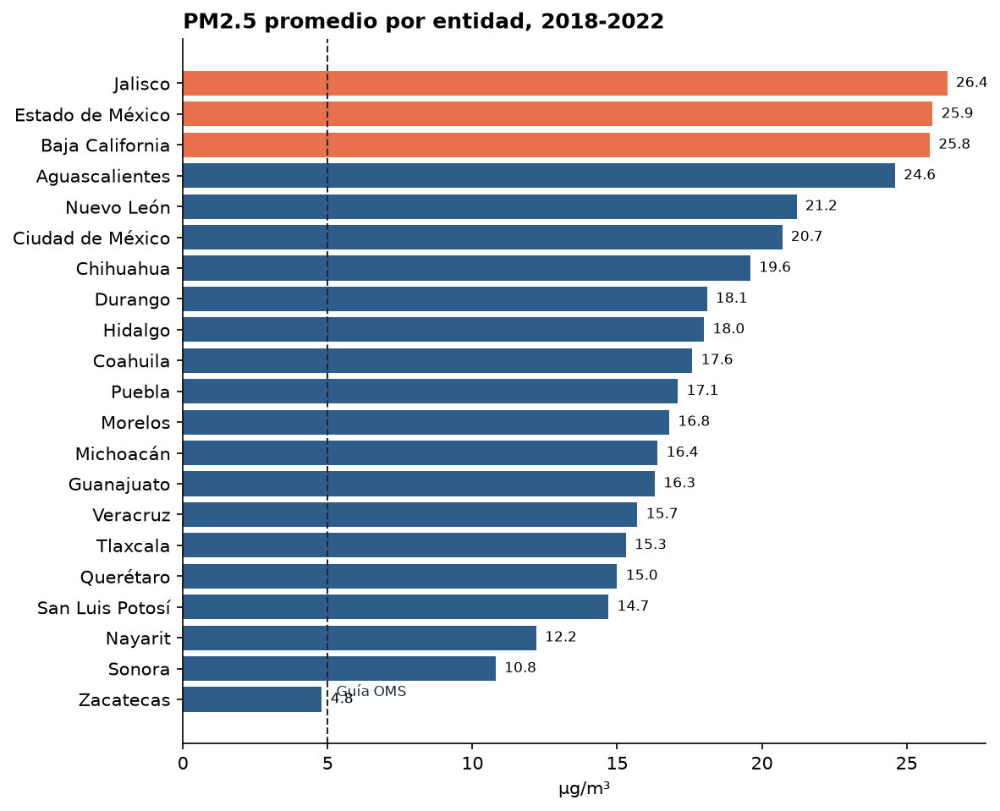
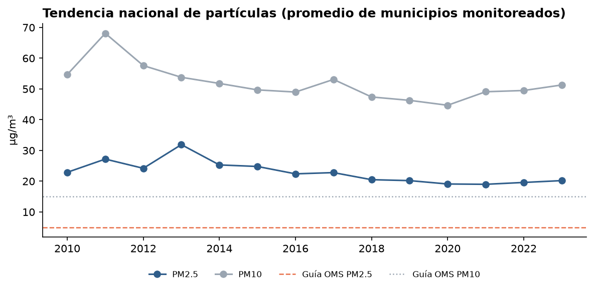

# S18 · Calidad del aire en México con Excel

**Módulo:** 02 · **Sesión:** 18 · Excel para análisis de datos I · **Fecha:** 2026-11-10

## Objetivo

Aplicar el proceso de la sesión, *de datos crudos a decisiones de negocio*, a un problema real de contaminación: la calidad del aire en las ciudades de México. Los datos vienen de la base pública mundial de la OMS.

| Pregunta | Métrica | Dimensión | Filtro | Análisis accionable |
|---|---|---|---|---|
| ¿Qué entidades de México respiran el aire más contaminado y cómo ha cambiado? | Promedio anual de PM2.5 en µg/m³ (`AVERAGE`) | Entidad (filas) y año (columnas) | Contaminante y año | Priorizar dónde invertir primero en control de emisiones y monitoreo |

## Entregables

| Archivo | Contenido |
|---|---|
| [`notebooks/01_calidad_aire_excel.ipynb`](notebooks/01_calidad_aire_excel.ipynb) | Procesamiento completo: descarga, limpieza, análisis y generación del Excel y el PDF |
| [`outputs/S18_Calidad_Aire_Mexico.xlsx`](outputs/S18_Calidad_Aire_Mexico.xlsx) | Libro de Excel con los 8 estadios del proceso y un dashboard con filtros |
| [`outputs/S18_Dashboard_Calidad_Aire_Mexico.pdf`](outputs/S18_Dashboard_Calidad_Aire_Mexico.pdf) | Dashboard en PDF que redacta todo el proceso y la decisión |

### Hojas del libro de Excel

| Hoja | Estadio de la clase |
|---|---|
| `00_Proceso` | Mapa del proceso y Excel Mindset |
| `01_Datos_Crudos` | 1. Datos crudos, tal como llegan |
| `02_Bitacora_Limpieza` | 2. Reglas de higiene aplicadas, con su equivalente en Excel |
| `03_Datos_Limpios` | 3. Tabla `tblCalidadAire` con columnas calculadas `Veces_Guia_PM25` y `Categoria_PM25` |
| `04_Formulas_Base` | 4. SUM, AVERAGE, COUNT, COUNTA e IF respondiendo preguntas |
| `05_Tabla_Dinamica` | 5. Entidad x Año con filtro de contaminante y escala de color |
| `06_Dashboard` | 6 y 7. KPIs y gráficas que responden a los filtros de contaminante y año |
| `07_Contexto_Mundial` | México frente a las regiones de la OMS |
| `08_Decision` | 8. Insight y decisión |

Las celdas naranjas son filtros: elige otro contaminante o año y todo se recalcula.

`openpyxl` no crea tablas dinámicas nativas ni segmentadores, así que la hoja `05_Tabla_Dinamica` la replica con `PROMEDIO.SI.CONJUNTO` y listas desplegables. La misma hoja trae los pasos para insertar la tabla dinámica nativa y un segmentador sobre `tblCalidadAire`.

## Datos

- **Fuente:** [WHO Ambient Air Quality Database, versión 8.0 (junio 2026)](https://www.who.int/publications/m/item/who-ambient-air-quality-database-(update-jun-2026)). Para México, las mediciones provienen del SINAICA del INECC.
- **Cobertura:** 868 registros de México, 114 municipios de 24 entidades, de 2010 a 2023, con promedios anuales de PM2.5, PM10 y NO2.
- **Referencia:** guías de calidad del aire de la OMS 2021, promedio anual: PM2.5 = 5, PM10 = 15 y NO2 = 10 µg/m³.

El archivo original (1.9 MB) no se sube al repositorio. El notebook lo descarga en `data/raw/` la primera vez que se ejecuta.

## Qué aprendí

- Un dato público oficial puede llegar sin estructura. La base de la OMS trae cada fila como texto CSV dentro de la columna A, partida en varias celdas cuando es larga.
- Las reglas de higiene se aplican antes de cualquier tabla dinámica: separar municipio y estado, unificar nombres repetidos y descartar mediciones con menos de 75% de cobertura del año.
- Formular primero pregunta, métrica y dimensión hace directo el mapeo a Filas, Columnas, Valores y Filtros.
- En Excel, un nombre definido no puede parecer una referencia de celda: `rPM25` sería la celda de la columna RPM, fila 25. Por eso los rangos se llaman `d_PM25`, `d_Anio`, etc.

## Cómo ejecutar

Desde la raíz del repositorio, con el entorno activado:

```bash
jupyter lab
```

Abre `notebooks/01_calidad_aire_excel.ipynb`, elige el kernel **Python (CPFIA)** y ejecuta **Run → Restart Kernel and Run All Cells**. Necesita conexión a internet la primera vez para descargar la base de la OMS.

## Resultados

Entre 2018 y 2022, el PM2.5 promedio de las ciudades monitoreadas de México fue de **19.6 µg/m³, 3.9 veces la guía de la OMS**, y el 99.2% de las mediciones municipales la superó. Las entidades con mayor PM2.5 fueron Jalisco, Estado de México y Baja California. Solo 22 de las 24 entidades con estaciones reportan PM2.5.






**Decisión:** concentrar el presupuesto de control de emisiones en Jalisco, Estado de México y Baja California, empezando por sus municipios con mayor PM2.5, y financiar monitores de PM2.5 en las entidades que hoy no lo miden.

**Limitaciones:** los promedios solo incluyen municipios con estaciones. La comparación mundial depende de cuántas ciudades mide cada región.

## Referencias

- World Health Organization. *WHO Ambient Air Quality Database, version 8.0*, 2026.
- World Health Organization. *WHO global air quality guidelines*, 2021.
- INECC. [Sistema Nacional de Información de la Calidad del Aire (SINAICA)](https://sinaica.inecc.gob.mx/).
- TCS Empowers / TecNM CPFIA. *Sesión 18: Excel para análisis de datos I*.
