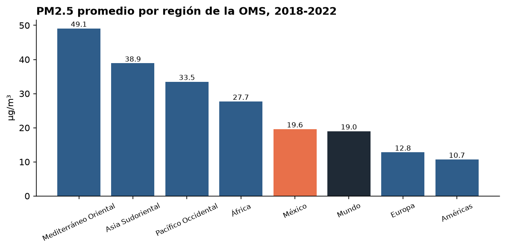

# S18 · Calidad del aire en México con Excel

**Módulo:** 02 · **Sesión:** 18 · Excel para análisis de datos I · **Fecha:** 2026-11-11

## Objetivo

Aplicar el proceso de la sesión, *de datos crudos a decisiones de negocio*, a un problema real de contaminación: la calidad del aire en las ciudades de México. Los datos vienen de la base pública mundial de la OMS.

| Pregunta | Métrica | Dimensión | Filtro | Análisis accionable |
|---|---|---|---|---|
| ¿Qué entidades de México respiran el aire más contaminado y cómo ha cambiado? | Promedio anual de PM2.5 en µg/m³ (`PROMEDIO`) | Entidad (filas) y año (columnas) | Región y año | Priorizar dónde invertir primero en control de emisiones y monitoreo |

## Flujo de trabajo

| Paso | Dónde | Etapas de la clase | Resultado |
|---|---|---|---|
| 1 | [`notebooks/01_preparacion_datos.ipynb`](notebooks/01_preparacion_datos.ipynb) | 1. Datos crudos · 2. Datos limpios | `data/processed/calidad_aire_mexico_limpio.xlsx` y valores de referencia |
| 2 | Excel, siguiendo [`GUIA_EXCEL.md`](GUIA_EXCEL.md) | 3. Tabla · 4. Fórmulas · 5. Tabla dinámica · 6. Gráficos · 7. Dashboard | `outputs/S18_Calidad_Aire_Mexico.xlsx` y capturas en `outputs/capturas/` |
| 3 | [`notebooks/02_reporte_pdf.ipynb`](notebooks/02_reporte_pdf.ipynb) | 8. Reporte de negocio | `outputs/S18_Dashboard_Calidad_Aire_Mexico.pdf`, con el notebook 01 completo como anexo |

Python solo prepara los datos y arma el PDF. Todo el análisis en Excel se hace a mano con herramientas nativas: Tabla, fórmulas, tabla dinámica, gráficos dinámicos y segmentadores. El PDF muestra cada paso con su captura y un texto propio.

## Datos

- **Fuente:** [WHO Ambient Air Quality Database, versión 8.0 (junio 2026)](https://www.who.int/publications/m/item/who-ambient-air-quality-database-(update-jun-2026)). Para México, las mediciones provienen del SINAICA del INECC.
- **Cobertura:** 868 registros de México de 2010 a 2023, con promedios anuales de PM2.5, PM10 y NO2. Después de la limpieza quedan 857 registros de 112 municipios en 24 entidades.
- **Referencia:** guías de calidad del aire de la OMS 2021, promedio anual: PM2.5 = 5, PM10 = 15 y NO2 = 10 µg/m³.

El archivo original (1.9 MB) no se sube al repositorio. El notebook 01 lo descarga en `data/raw/` la primera vez que se ejecuta.

## Cómo ejecutar

Desde la raíz del repositorio, con el entorno activado:

```bash
jupyter lab
```

1. Abre `notebooks/01_preparacion_datos.ipynb`, elige el kernel **Python (CPFIA)** y ejecuta las celdas una por una. Necesita internet la primera vez.
2. Sigue `GUIA_EXCEL.md` en Excel y guarda las capturas en `outputs/capturas/`.
3. Escribe tus textos en la sección 3 de `notebooks/02_reporte_pdf.ipynb` y ejecuta **Run → Restart Kernel and Run All Cells**. Requiere Google Chrome para convertir el anexo y la librería `pypdf` de `requirements.txt` para unir el PDF.

## Qué aprendí

- Un dato público oficial puede llegar sin estructura. La base de la OMS trae cada fila como texto CSV dentro de la columna A, partida en varias celdas cuando es larga.
- Las reglas de higiene se aplican antes de cualquier tabla dinámica: separar municipio y estado, unificar nombres repetidos y descartar mediciones con menos de 75% de cobertura del año.
- Formular primero pregunta, métrica y dimensión hace directo el mapeo a Filas, Columnas, Valores y Filtros.

## Resultados

Entre 2018 y 2022, el PM2.5 promedio de las ciudades monitoreadas de México fue de **19.6 µg/m³, 3.9 veces la guía de la OMS**, y el 99.2% de las mediciones municipales la superó. Las entidades con mayor PM2.5 fueron Jalisco, Estado de México y Baja California. Solo 22 de las 24 entidades con estaciones reportan PM2.5.



**Limitaciones:** los promedios solo incluyen municipios con estaciones. La comparación mundial depende de cuántas ciudades mide cada región.

## Referencias

- World Health Organization. *WHO Ambient Air Quality Database, version 8.0*, 2026.
- World Health Organization. *WHO global air quality guidelines*, 2021.
- INECC. [Sistema Nacional de Información de la Calidad del Aire (SINAICA)](https://sinaica.inecc.gob.mx/).
- TCS Empowers / TecNM CPFIA. *Sesión 18: Excel para análisis de datos I*.
